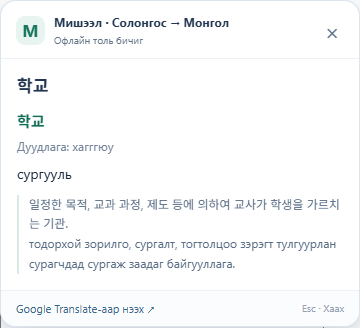
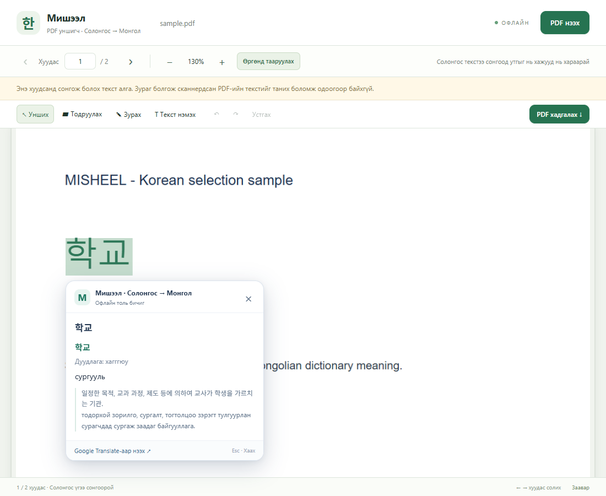
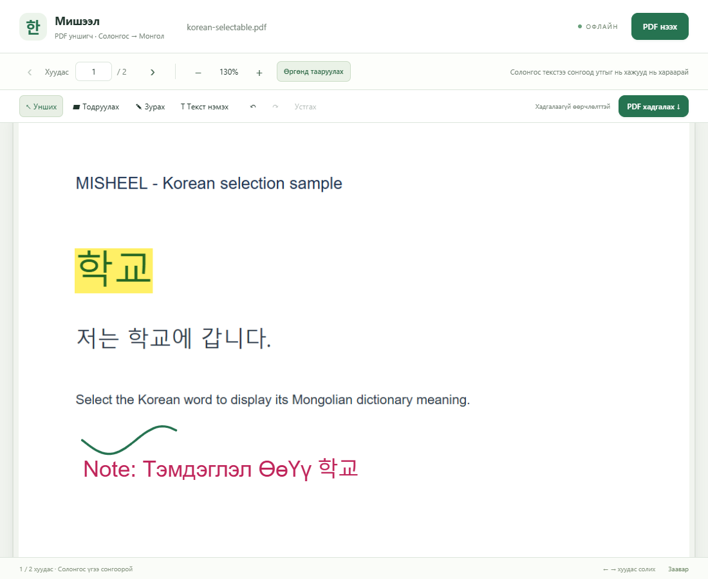

# Misheel · Мишээл

**한국어 텍스트를 선택하면 바로 옆에 몽골어 뜻이 표시되는 Chrome / Edge용 오프라인 사전 확장 프로그램입니다.** 웹페이지와 로컬 HTML에서 사용할 수 있으며, 브라우저에서 PDF를 열면 Misheel 리더로 자동 전환됩니다. PDF에서도 선택만으로 뜻을 확인하고, 형광펜·펜·텍스트 주석을 추가한 PDF를 저장할 수 있습니다. 인터페이스는 몽골어입니다.

[Монгол заавар](README.md) · [한국어 안내](README.ko.md) · [확장 프로그램 ZIP 다운로드](misheel-extension.zip)



## 설치

Chrome 125 이상 또는 이에 해당하는 Chromium 기반 Edge를 사용합니다. 사용할 때 Node.js, Python, API 키 또는 계정은 필요하지 않습니다. 다음 방법 중 하나로 파일을 다운로드하고 **계속 보관할 폴더에 압축을 풉니다.**

- **설치용 패키지:** [misheel-extension.zip](misheel-extension.zip)을 내려받아 압축을 풉니다. 압축을 푼 폴더에 `manifest.json`이 있습니다.
- **저장소 전체 다운로드:** GitHub의 **Code → Download ZIP**을 선택하고 압축을 풉니다. 그 안의 **`extension/` 폴더**를 사용합니다. 저장소를 clone했다면 같은 폴더를 선택합니다.

이어서 브라우저에 설치합니다.

1. Chrome 주소창에 `chrome://extensions`, Edge 주소창에 `edge://extensions`를 입력합니다.
2. **개발자 모드 / Developer mode**를 켭니다.
3. **압축해제된 확장 프로그램을 로드합니다 / Load unpacked**를 누릅니다.
4. **`manifest.json`이 들어 있는 폴더**를 선택합니다. 저장소 전체 ZIP은 `extension/` 폴더, 설치용 ZIP은 압축을 푼 폴더를 선택합니다.
5. 이미 열려 있던 웹페이지를 **새로고침**합니다. 브라우저의 확장 프로그램 메뉴에서 Misheel을 툴바에 고정하면 직접 검색과 PDF 리더를 쉽게 열 수 있습니다.

자세한 설치 절차는 [Chrome 공식 안내](https://developer.chrome.com/docs/extensions/get-started/tutorial/hello-world#load-unpacked), [Edge 공식 안내](https://learn.microsoft.com/en-us/microsoft-edge/extensions/getting-started/extension-sideloading)를 참고할 수 있습니다.

## 웹페이지에서 사용

1. 한국어 단어나 짧은 구절을 드래그하여 선택합니다. 단어를 두 번 클릭하거나 키보드로 선택해도 됩니다.
2. 선택한 텍스트 옆에 몽골어 뜻이 표시됩니다. 사전에 있으면 발음과 한국어·몽골어 뜻풀이도 함께 표시됩니다.
3. **Esc**, **×** 또는 카드 바깥을 눌러 닫습니다.

툴바의 **Мишээл** 아이콘을 누르면 단어를 직접 검색하거나 선택 시 자동으로 표시하는 기능을 켜고 끌 수 있습니다. `학교`, `사과`, `한국어`로 먼저 시험해 보세요.

## 로컬 HTML 및 PDF 파일

### HTML 파일

컴퓨터에 저장된 `.html` 파일을 Chrome이나 Edge에서 열고 일반 웹페이지처럼 텍스트를 선택합니다. `file://` 페이지에서 실행하려면 다음 설정이 필요합니다.

1. `chrome://extensions` 또는 `edge://extensions`에서 Misheel의 **세부정보 / Details**를 엽니다.
2. **파일 URL에 대한 액세스 허용 / Allow access to file URLs**을 켭니다.
3. HTML 파일 탭을 새로고침하고 한국어 텍스트를 선택합니다.

### PDF 파일



**PDF를 브라우저에서 열고 한국어 텍스트를 선택하면 바로 뜻이 표시됩니다.** 웹 PDF와 접근이 허용된 로컬 PDF를 **같은 탭의** Misheel 리더에서 자동으로 엽니다. 우클릭 메뉴를 누르거나 PDF 파일을 다시 고를 필요가 없습니다.

1. 컴퓨터의 `.pdf` 파일을 Chrome / Edge로 열거나 웹 PDF 링크를 엽니다. 로컬 파일을 자동으로 열려면 Misheel의 **세부정보 → 파일 URL에 대한 액세스 허용**을 한 번 켭니다.
2. Misheel 리더가 자동으로 열립니다. 기본 모드는 **Унших**(읽기)입니다.
3. 한국어 단어나 구절을 드래그하여 선택합니다. 선택한 부분 옆에 몽골어 뜻이 나타납니다. 페이지 이동, 확대·축소, 너비 맞춤으로 문서를 읽을 수 있습니다.

툴바 팝업의 **PDF-ийг автоматаар нээх**(PDF 자동 열기)는 기본으로 켜져 있습니다. 끄면 브라우저의 기본 PDF 뷰어를 사용합니다. 기본 뷰어에 사전 카드를 삽입하는 방식이 아니라, PDF를 Misheel 리더로 열어 텍스트 선택과 주석 기능을 제공합니다. 웹 PDF가 열린 최상위 탭을 대상으로 하며, HTML 페이지 안에 삽입된 PDF iframe 때문에 전체 페이지를 리더로 전환하지는 않습니다.

직접 파일을 고르려면 팝업의 **PDF файл нээх**(PDF 파일 열기) → 리더의 **PDF файл сонгох**(PDF 파일 선택)를 누릅니다. 파일을 리더로 드래그해도 되며, 최대 200MB 파일을 열 수 있습니다. 이 방법은 **파일 URL에 대한 액세스 허용** 설정이 필요하지 않습니다. 이미 열린 PDF에는 팝업의 **Энэ PDF-ийг Мишээлээр нээх**(이 PDF를 Misheel에서 열기) 버튼도 사용할 수 있습니다. 권한, 로그인 또는 리디렉션 때문에 링크로 열 수 없으면 PDF를 다운로드한 뒤 파일 선택 버튼으로 엽니다.

### PDF 주석과 저장



Edge의 PDF 도구처럼 형광펜으로 강조하고, 펜으로 그리며, 텍스트 메모를 추가할 수 있습니다. 리더의 도구 모음을 사용합니다.

| 도구 | 사용 방법 |
| --- | --- |
| **Унших**(읽기) | 한국어 텍스트를 선택하여 몽골어 뜻 확인 |
| **Тодруулах**(강조) | 텍스트를 드래그하여 색으로 강조 |
| **Зурах**(그리기) | 마우스나 펜으로 페이지에 그리기; 색과 펜 굵기 선택 |
| **Текст нэмэх**(텍스트 추가) | 페이지를 눌러 메모 입력; 색과 글자 크기 선택 |
| **↶ / ↷** | 주석 작업 실행 취소 / 다시 실행 |
| **Устгах**(삭제) | 선택한 주석 삭제 |
| **PDF хадгалах**(PDF 저장) | 주석이 포함된 PDF 사본 다운로드 |

주석 모드에서는 사전 카드가 표시되지 않습니다. 단어 뜻을 보려면 **Унших**(읽기)로 돌아갑니다. 텍스트 추가는 페이지 위에 새 메모를 넣는 기능이며, 원본 PDF의 본문 문장을 교체하는 편집 기능은 아닙니다.

**PDF хадгалах**(PDF 저장)을 누르면 `원래파일명-misheel.pdf`라는 새 PDF를 다운로드합니다. 형광펜·펜·텍스트 메모를 표준 PDF 주석으로 저장하므로, 저장한 파일을 Misheel, Edge 및 다른 PDF 리더에서 다시 열어 볼 수 있습니다. 파일을 닫기 전에 변경 사항을 저장하세요.

비밀번호로 보호된 PDF에 몽골어·한국어 텍스트 주석을 저장하려면 비밀번호 보호를 해제한 PDF 사본이 필요할 수 있습니다. 저장 오류가 나면 편집 내용은 현재 열린 리더에 남아 있습니다.

로컬 PDF 열기·주석·저장과 사전 검색은 오프라인으로 작동합니다. PDF를 서버에 업로드하지 않습니다. 웹 PDF를 열 때는 해당 PDF의 원본 사이트에서 파일을 다운로드합니다. 사전 카드는 **텍스트를 선택할 수 있는 PDF**에서 작동합니다. 스캔한 이미지 형태의 PDF를 위한 OCR 기능은 포함되어 있지 않습니다.

## 수록 데이터

Misheel Android APK에 포함된 오프라인 한국어–몽골어 사전 데이터를 사용합니다.

| 항목 | 수량 |
| --- | ---: |
| 단어 항목 | 51,794 |
| 단어의 뜻 | 71,500 |
| 관용구 | 2,225 |
| 속담 | 652 |
| 관용구·속담의 뜻과 설명 | 3,190 |
| 단어·관용구·속담의 전체 항목 | 54,671 |

단어 항목에는 같은 표기에 여러 뜻을 가진 항목이 포함됩니다. 상세한 수량, 원본 데이터 해시와 내보내기 기록은 [extension/data/index.json](extension/data/index.json)에 있습니다.

결과에 함께 표시되는 한국어·몽골어 문장은 **뜻풀이**이며, 번역된 사용 예문이 아닙니다. 원본의 1,684개 항목은 짧은 몽골어 뜻이 비어 있어 해당 항목에 남아 있는 다른 설명을 보존했습니다. 몽골어 번역이 없는 사용 문장 4,479개는 내보내기에서 제외했습니다.

## 검색 범위와 개인정보

- 단어, 사전에 있는 구절, 관용구와 속담을 먼저 정확히 검색합니다. 전체 구절이 없으면 그 안에서 찾은 한국어 단어의 뜻을 개별적으로 표시합니다.
- 일부 조사와 규칙적인 동사 어미를 제거하거나 바꾸어 기본형을 찾습니다. 한국어의 모든 활용형을 분석하지는 않으므로 찾지 못하면 기본형으로 검색해 보세요.
- **문장 전체를 새로 번역하는 기계번역 기능은 아닙니다.** Google Translate 링크를 직접 누를 때 선택한 텍스트가 Google Translate로 전달되며, 그곳에서 문장을 번역할 수 있습니다.
- 한 번에 **최대 500자**를 선택할 수 있습니다. 구절 검색에서는 서로 다른 단어 20개까지 검사하며 사전 항목을 최대 16개 표시합니다. 제한에 도달하면 카드에 안내합니다.
- 사전과 PDF 리더는 오프라인으로 작동합니다. 선택한 텍스트나 로컬 파일을 서버로 자동 전송하지 않습니다.
- 일반 HTTP/HTTPS 페이지, 허용된 iframe, 파일 URL 접근을 허용한 로컬 HTML, Misheel PDF 리더에서 작동합니다. 브라우저 설정, 새 탭, 확장 프로그램 스토어, 기본 PDF 뷰어, input/textarea 등 입력 영역에는 선택 카드가 표시되지 않습니다.

## 프로젝트 구조

| 경로 | 내용 |
| --- | --- |
| [extension/](extension/) | 빌드 없이 바로 설치하는 Manifest V3 확장 프로그램 |
| [misheel-extension.zip](misheel-extension.zip) | 설치용 확장 프로그램 ZIP |
| [extension/data/](extension/data/) | 데이터 정보와 첫 글자별로 나눈 오프라인 사전 |
| [extension/pdf.html](extension/pdf.html) | PDF 자동 열기, 선택 사전과 저장 가능한 주석 기능을 제공하는 리더 |
| [tools/export_dictionary.py](tools/export_dictionary.py) | Python 표준 라이브러리로 작성한 APK Realm 사전 내보내기 도구 |
| [tools/package.ps1](tools/package.ps1) | 확장 프로그램 ZIP을 생성하는 PowerShell 스크립트 |
| [tests/](tests/) | 검색 로직, 내보낸 데이터와 브라우저 동작 검사 |

필요한 사전 파일만 읽고 background service worker에 최대 5개를 캐시합니다. 선택 카드는 Shadow DOM을 사용하며 사전 내용을 일반 텍스트로 표시합니다. PDF 리더에 포함된 PDF.js의 라이선스는 [extension/vendor/pdfjs/LICENSE](extension/vendor/pdfjs/LICENSE)에 보존되어 있습니다.

## 개발 및 데이터 다시 내보내기

일반 사용에는 개발 도구가 필요하지 않습니다. 검사에는 Node.js, 브라우저 검사에는 Playwright와 Chromium/Chrome, ZIP 패키징에는 PowerShell을 사용합니다.

```powershell
# 검색 로직과 내보낸 사전 데이터 검사
npm test

# 브라우저 검사 도구 설치 및 실행
npm install --no-save playwright
npx playwright install chromium
npm run test:browser
npm run test:pdf
npm run test:automatic
npm run test:annotations

# Windows / PowerShell: 설치용 ZIP 다시 생성
npm run package
```

`PLAYWRIGHT_MODULE`과 `BROWSER_EXECUTABLE` 환경 변수로 Playwright 또는 브라우저 경로를 지정할 수 있습니다. 검사 보고서와 스크린샷은 `artifacts/`에 생성됩니다.

원본 Android **APK는 저장소에 포함되지 않습니다.** 설치 가능한 사전 데이터는 이미 포함되어 있으므로 사용 전에 내보내기 도구를 실행할 필요가 없습니다. 데이터를 다시 내보내려면 Python 3와 해당 APK 파일을 직접 준비합니다.

```powershell
python tools/export_dictionary.py --apk "C:\path\to\misheel.apk"
npm test
npm run package
```

이 내보내기 도구는 해당 APK의 `assets/realm/default.realm`, Realm 파일 형식 20과 스키마에 맞춰 작성되었습니다. 다른 APK 버전은 별도 확인이 필요하며, 도구는 원본 APK를 수정하지 않습니다. `tools/make-icons.py`를 다시 실행하려면 Pillow와 Windows의 Malgun Gothic 글꼴이 필요합니다. 완성된 아이콘은 확장 프로그램에 포함되어 있습니다.

확장 프로그램의 코드나 데이터를 변경한 후에는 확장 프로그램 관리 화면에서 **새로고침 / Reload**하고 사용하는 웹페이지도 새로고침합니다.
